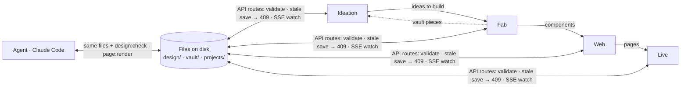
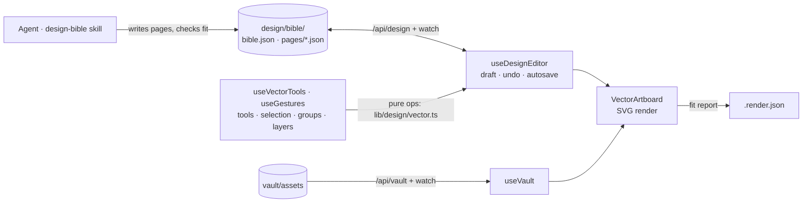
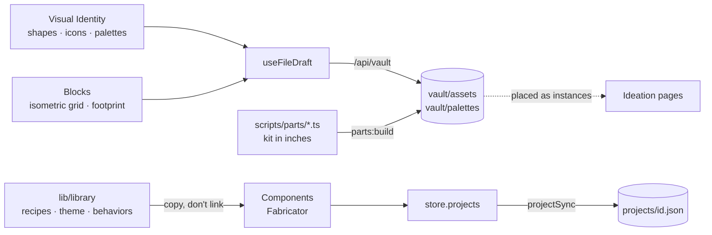
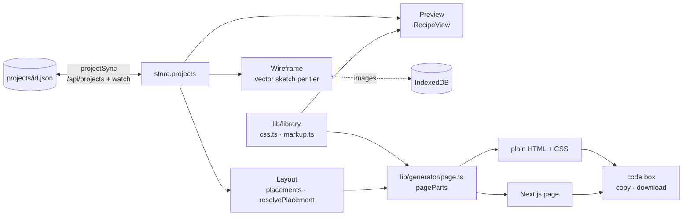
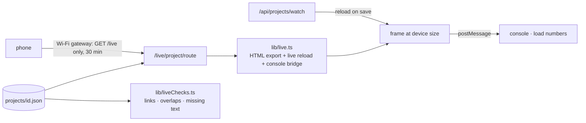

# Alchemy

[](https://github.com/alchemypls/alchemylab/actions/workflows/ci.yml)

Hello pls! Welcome to Alchemy (a work in progress): my personal design and mock-up workspace. It's also where I work
with AI agents to build tools and do a little R&D, and a place to learn, test, mess up and try again.

I wanted to switch between workflows more easily, in one unified space with settings that feel comfy. After a few
iterations I settled on four canvases with different roles, all connected, each feeding the others: a pipeline for
design and development.

<!-- Screenshot or short video of the four canvases goes here -->

## Four pillars

1. **My own workspace:** custom design tools, built the way I work.
2. **Built to work with agents:** the agent (Claude) uses the same files and checks I do.
3. **One connected workflow:** what's made on one canvas is used by the next.
4. **Ready to show:** vector design pages, and web mock-ups that run for real.

## The canvases

| Canvas | Role | What happens there |
|---|---|---|
| **Ideation** | Design and iteration | The design bible: one-page vector docs, one per topic, with a status on every decision. I start here and work things out before any code is written. |
| **Fab** | Making assets | Reusable vector pieces (shapes, icons, game blocks) and web components, made here and used everywhere else. |
| **Web** | Layout and design iteration | Pages laid out from the components made in Fab: wireframe, layout and preview, for phone, tablet and desktop. The goal is my own component library, starting from the smallest pieces (atoms) and growing into a suite of different styles. |
| **Live** | Running preview and checks | The mock-up running as a real web page, at a real device size, with its console, load numbers and checks for broken links, overlaps and missing text. |

Alt + WASD (or the arrow keys) moves between them.



### Each canvas

**Ideation**: a design bible page, live from disk.



**Fab**: one editor at a time, making the pieces everything else uses.



**Web**: a project's page in three layers, and its export.



**Live**: the export running for real, like browser dev tools.



## Why I built it

- I didn't want to pay for Figma.
- I wanted a space to test ideas and do R&D, and to make my own tools.
- I wanted to work with agents using the same tools I use.
- I wanted the output to be presentation-ready: vector design pages and live web components.

## Working with an agent

Everything Alchemy makes is a plain file in this folder, so the agent works on the same things I do, and each of us
sees the other's changes live:

- **Design bibles** (`design/`): the agent runs design conversations and writes the pages (the `design-bible` skill).
- **Vault pieces** (`vault/`): drawn on Fab, or written as code in `scripts/parts/` and built into the vault.
- **Web projects** (`projects/`): laid out on Web, served by Live.

Since the agent can't see the canvas, it checks its work with commands: `design:check` validates every file and reports
text that doesn't fit, and `page:render` draws a page to an image. Saves from an older copy of a file are refused, so
neither of us overwrites the other. `CLAUDE.md` is the agent's guide to the codebase.

## What's next

Loosely, and open to change: finishing the pinball design bible and my own mock-up of the table, building out the
component library on Fab and Web, and a short video walkthrough of the canvases.

## Getting started

```bash
npm install
npm run dev
```

Open [http://localhost:3000](http://localhost:3000).

Alchemy is a local tool: it reads and writes files in this folder and has no login, so it only answers the computer
it runs on. To try a Live page on your phone, use **Share on this Wi-Fi** in the Live canvas's phone box: phones can view
pages, never edit them, and sharing turns itself off after 30 minutes. Don't deploy it to a server.

## Controls

| Action | How |
|---|---|
| Switch canvas | Alt + WASD / arrows |
| Pan | Space + drag, or middle-drag |
| Zoom | Mouse wheel (trackpad pinch) |
| Fit / 100% | Ctrl + 0 / Ctrl + 1 |
| Tools | V select · S shapes · T text · P pen · E eraser · Z floor zone · X place from vault · H read and pan |
| Tool settings | Click the tool in the rail again |
| Grid | G |
| Undo / redo | Ctrl + Z / Ctrl + Shift + Z |
| Copy / cut / paste (between pages too) | Ctrl + C / X / V |
| Group / ungroup | Ctrl + G / Ctrl + Shift + G |
| Duplicate / delete | Ctrl + D / Del |
| Nudge | Arrows (Shift: ×5) |
| Layers | 1 / 2 / 3, Ctrl + wheel, or the pips beside the minimap |

## Commands

```bash
npm run dev            # dev server on :3000
npm run build          # production build
npm run lint           # ESLint
npm test               # tests (Vitest): edit ops, the export, and the guards on your files
npm run design:check   # validate design bibles and report page fit
npm run parts:build    # vault parts written as code (scripts/parts) → vault/assets
npm run asset:render   # PNGs of vault assets in .render/ (needs inkscape + ImageMagick)
npm run asset:info     # vault assets summarized in inches
npm run page:render    # a bible page as an image, through the real artboard
```

## Stack

Next.js 14 (App Router) · React · Zustand · Framer Motion · Tailwind CSS · TypeScript (strict)

The workbench is built with React and Tailwind, but what it exports uses neither: web pages come out as plain HTML and
CSS, or a Next.js page.

## Layout

```
app/        — the root page, API routes for design/, vault/, projects/ (validated writes, mtime conflicts, SSE watches), /live
lib/        — pure logic: design pages and vector geometry, vault, layers, the component library, the page generator, store
workbench/  — canvases, hooks, shared UI (vector tools, sheet shell, panels)
scripts/    — parts build, renders, checks, the pen bridge (USB tablet or reMarkable)
design/ vault/ projects/  — content on disk
```

See `CLAUDE.md` for the full guide.
